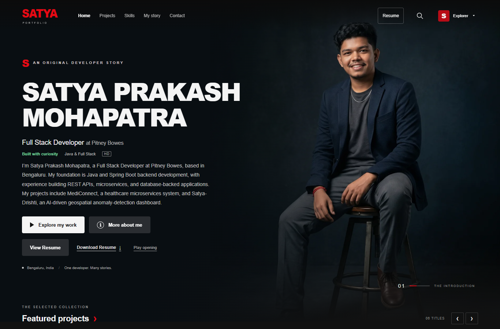
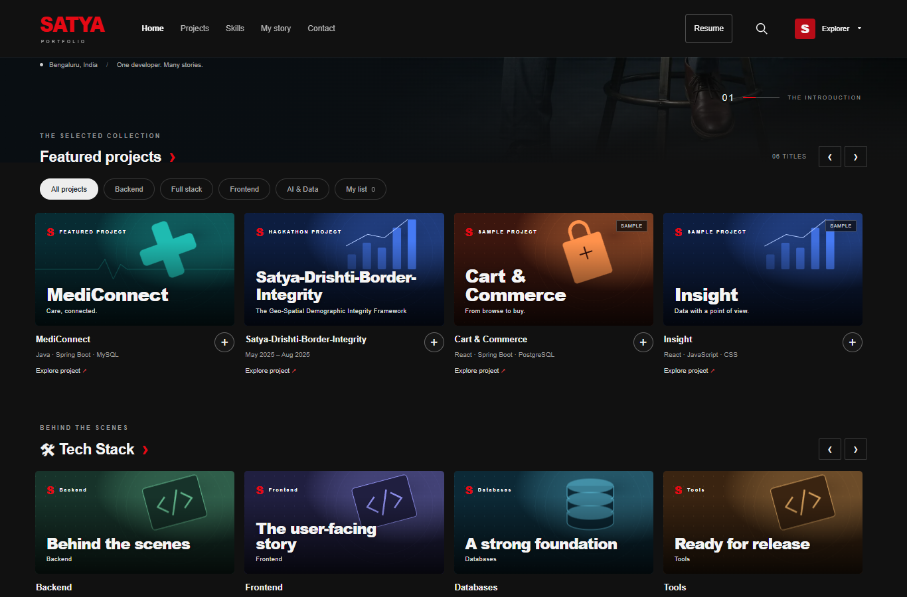
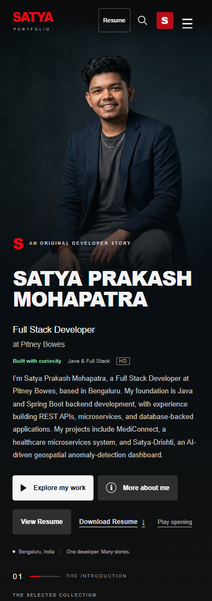

# Satya Prakash Mohapatra — Personal Portfolio

A cinematic developer portfolio presenting my projects, experience, education, credentials, and technical skills. Built with plain HTML, CSS, and JavaScript, it combines a portrait-led introduction with browsable content rows and accessible detail dialogs.

**[Visit the live portfolio → https://satya-prakash-mohapatra.netlify.app/](https://satya-prakash-mohapatra.netlify.app/)**

[GitHub profile](https://github.com/falcon-2002) · [LinkedIn](https://www.linkedin.com/in/satya-prakash-mohapatra-767728231) · [Resume (PDF)](dist/assets/Satya_Prakash_Mohapatra_Resume.pdf)

## Screenshots

Actual browser captures of this repository, taken on 7 November 2026. The screenshots show the implemented website, not design mockups.





<details>
<summary>Mobile view</summary>



</details>

## Features

- Cinematic opening with an immediately available skip route; visitor profiles are optional and never hide content.
- Responsive portrait hero, About dialog, and horizontal content rows.
- Project details, search, category filters, and a saved-project list stored in the visitor's browser.
- Experience, education, grouped Tech Stack cards, and credential details.
- Resume preview on desktop, with direct PDF open and download options on mobile.
- Email and social links, keyboard navigation, visible focus, modal focus containment/restoration, and reduced-motion support.
- Centralized content configuration, bundled artwork, and responsive portrait images with no runtime image-service dependency.

## Technologies used in this website

| Area | Implementation |
| --- | --- |
| Interface | HTML5, CSS3, vanilla JavaScript |
| Browser APIs | Native dialog, localStorage, sessionStorage, IntersectionObserver, matchMedia |
| Local server and checks | Node.js built-ins; no npm dependencies |
| Media | SVG artwork, PNG original portrait, responsive WebP images, supplied PDF |
| Optional asset preparation | Python; Pillow only for regenerating portrait variants |
| Hosting | Static files; Netlify configuration included |

The Java, Spring Boot, React, and other technologies listed in the portfolio describe my skills and individual projects. They are not dependencies of this website. There is no React/Vite application, backend API, database, or contact-form service in this repository.

## Run locally

Requires Node.js 18 or later; checks also run in CI with Node.js 24. No `npm install` is needed.

```sh
git clone https://github.com/falcon-2002/satya-cinema-portfolio.git
cd satya-cinema-portfolio
npm start
```

Open **http://localhost:3000**. Stop the server with Ctrl+C.

If port 3000 is unavailable, or PowerShell blocks `npm.ps1`:

```powershell
npm.cmd start -- --host 127.0.0.1 --port 4173
```

Open **http://127.0.0.1:4173**. The server is for local development.

## Checks and production output

```sh
npm run check
```

This checks JavaScript syntax, configured local assets, duplicate IDs, and documentation links. GitHub Actions runs the same checks on pushes and pull requests. See [QA.md](QA.md) for browser verification and limitations.

**No production build is required.** There is deliberately no `npm run build` script. The `dist/` directory contains the editable source and the complete deployable website; it is not generated output. Keep it in Git and do not delete it in preparation for a build.

## Deploy to Netlify

Import this GitHub repository as an existing project. Use these settings:

| Setting | Value |
| --- | --- |
| Production branch | `main` |
| Framework preset | None / Other |
| Base directory | Leave empty (repository root) |
| Package directory | Leave empty |
| Build command | Leave empty |
| Publish directory | `dist` |
| Functions directory | None |
| Environment variables | None required |

[netlify.toml](netlify.toml) explicitly sets an empty build command and `publish = "dist"`. There is no compilation, server process, or framework adapter to run on Netlify. All site assets, including the photo and resume, are inside `dist/`. Only that directory is published; repository documentation and screenshots stay outside it.

The portfolio is live at [satya-prakash-mohapatra.netlify.app](https://satya-prakash-mohapatra.netlify.app/). This URL is also configured as the portfolio project's public demo in `dist/config.js`. Keep that field and the link above synchronized if the domain changes. Do not use a localhost address as a public demo.

Official references: [Netlify build settings](https://docs.netlify.com/build/configure-builds/overview/) and [file-based configuration](https://docs.netlify.com/build/configure-builds/file-based-configuration/).

An optional [GitHub Pages workflow](.github/workflows/pages.yml) is retained for manual use after Pages is configured. It does not deploy automatically when this repository is pushed.

## Customize

| Content | Where to edit |
| --- | --- |
| Name, role, employer, location, biography | `dist/config.js` — top-level profile fields |
| Projects and verified repository/public-demo links | `dist/config.js` — `projects` |
| Skills, experience, education, credentials | `dist/config.js` — `skills`, `experience`, `certifications` |
| Email, GitHub, LinkedIn | `dist/config.js` — `email`, `github`, `linkedin` |
| Portrait and alternative text | `dist/config.js` — `portrait`; files in `dist/assets/` |
| Resume | `dist/assets/Satya_Prakash_Mohapatra_Resume.pdf`; `resume` in `dist/config.js` |
| Page structure and search metadata | `dist/index.html` |
| Rendering and interactions | `dist/app.js` |
| Styling and responsive layouts | `dist/styles.css` |

The supplied portrait PNG and PDF are preserved unchanged. To regenerate the resized WebP copies from the local PNG, install Pillow in a Python environment and run `python scripts/prepare-portrait.py`. This is optional asset preparation, not a build or runtime requirement.

Empty project and verification links render explicit placeholders. Cart & Commerce, Insight, and Taskflow are labeled sample concepts. Keep those labels until replacing them with actual work. Outstanding factual details are documented in [Content notes](docs/CONTENT_NOTES.md).

## Implementation and attribution

This portfolio extends the plain HTML/CSS/JavaScript architecture and rendering patterns of an MIT-licensed cinematic portfolio template. Work implemented here includes the configured personal content, project search and filters, browser-local saved projects, accessible dialog interactions, responsive portrait integration, optional opening/profile navigation, and resume viewing/downloads.

The template's copyright and license are retained in [LICENSE](LICENSE). [THIRD_PARTY_NOTICES.md](THIRD_PARTY_NOTICES.md) records the code/design reference and the separate presentation-only reference whose code and personal assets were not copied. This project does not claim that the entire design or codebase was created from scratch, and is not affiliated with Netflix.

The personal photo and resume are supplied assets; the software license does not grant rights to reuse them as someone else's identity or credentials.
